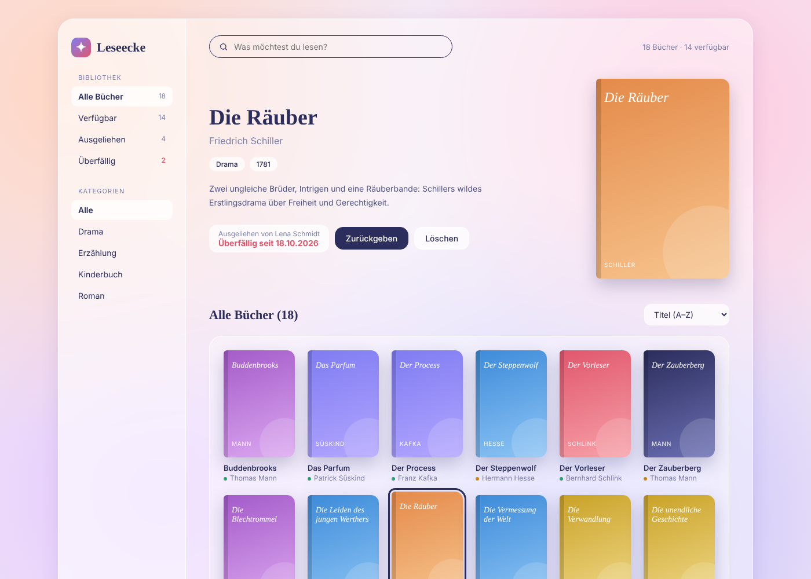

# Leseecke

A small library app where you can search books, borrow them and give them back.
I built it to learn FastAPI and how a frontend talks to a backend.



## Features

- Search books by title or author
- Filter by category and status (available, borrowed, overdue)
- Sort by title, author or year
- Borrow a book with a name and a loan period (1–4 weeks)
- Overdue books are marked in red
- Add and delete books
- Data is saved in a SQLite database

## Built with

- Python, FastAPI
- SQLite
- HTML, CSS, JavaScript

## How to run

```bash
pip install -r requirements.txt
uvicorn main:app --reload
```

Then open http://127.0.0.1:8000 in the browser.

The API documentation is at http://127.0.0.1:8000/docs.

## Tests

```bash
pytest
```

## API

| Method | URL | What it does |
| ------ | --- | ------------ |
| GET | `/api/books` | List books (with search, filter and sort) |
| GET | `/api/books/{id}` | Get one book |
| POST | `/api/books` | Add a book |
| DELETE | `/api/books/{id}` | Delete a book |
| POST | `/api/books/{id}/borrow` | Borrow a book |
| POST | `/api/books/{id}/return` | Return a book |
| GET | `/api/categories` | List all categories |
| GET | `/api/stats` | Number of available, borrowed and overdue books |

## Planned

- Edit books
- Dark mode


